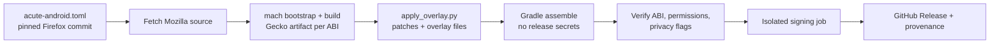

# Acute Web for Android: architecture

Acute is **not a fork**. The repository holds an auditable overlay that CI
applies to one reviewed commit of Mozilla's Firefox for Android source.

## Build model

| Input | Where |
|---|---|
| Acute source | This repository at a commit or tag |
| Mozilla source | Full commit in `acute-android.toml`, the workflow env `PINNED_FIREFOX_REF`, and the dispatch default |
| Modifications | `scripts/apply_overlay.py` |
| Resources and code | `overlay/res`, `overlay/beta-res`, `overlay/assets`, `overlay/kotlin` |

## The overlay

`scripts/apply_overlay.py` (about 1,550 lines) holds every upstream change as a
named function: `patch_product_branding`, `patch_manifest`,
`patch_tablet_defaults`, `patch_desktop_shortcuts`, `patch_marketing_policy`,
`patch_user_reporting`, `patch_core_glass_*`, `patch_midnight_pages`, and others.

- **Fail-closed matching.** Each edit uses `replace_once`, which raises
  `OverlayError` unless the anchor text appears exactly once. Moving to a new
  upstream version therefore surfaces every changed assumption as a build
  failure to review.
- **Required files.** `apply()` checks that every upstream file it touches
  exists before patching.
- **Channel-aware.** Stable and Beta get different labels, launcher assets
  (the Beta badge) and features (CORE Glass, Midnight Pages).
- **Product identity validation.** After branding, the overlay checks that
  product-facing Firefox branding is gone, keeping only accurate legal and engine disclosures.
- **Overlay files.** `copy_overlay()` installs Acute resources, the Midnight
  Pages extension and `GitHubUpdateProvider.kt`.

## Updater

`overlay/kotlin/GitHubUpdateProvider.kt` adds a non-exported content provider in
package `org.mozilla.fenix.acute`. It:

- queries the GitHub Releases API for the matching channel (latest release for
  Stable, recent prereleases for Beta), at most every six hours;
- picks the APK that matches the device ABI;
- presents the release and hands the APK to Android's package installer, so
  Android enforces signature continuity.

The audit enforces HTTPS and GitHub-origin restrictions for this code.

## Native architectures

Each build targets exactly one ABI (`ACUTE_TARGET_ABI`). Gradle excludes every
other native folder, and `scripts/verify_apk_native.py` rejects foreign ABI
directories, missing Gecko/JNA/application-services libraries, or mislabeled
ELF binaries. This came from a 1.1.0 startup crash on Waydroid
(`UnsatisfiedLinkError: libxul`), where the ARM64 APK contained partial x86_64 libraries.

## Release channels

| Channel | Branch | App ID | Tag |
|---|---|---|---|
| Stable | `main` | `com.acuteweb.browser` | `vX.Y.Z` |
| Beta | `beta` | `com.acuteweb.browser.beta` | `vX.Y.Z-beta.N` (prerelease) |

Beta installs alongside Stable with a separate profile. Features land on
`beta` and are promoted only after phone, tablet, upgrade and update-channel testing.

## Large screens

On devices with a smallest width of at least 600 dp: a persistent tab strip,
an expanded toolbar, fixed browser chrome, desktop mode for new tabs,
split-screen, picture-in-picture, keyboard shortcuts, and mouse back/forward.
See `docs/TABLET_SUPPORT.md`.

## Tooling

| Command | Does |
|---|---|
| `make check` | `scripts/check_project.py`: project metadata consistency |
| `make test` | `unittest` suites: overlay fixtures, project, site release, APK native checks |
| `make audit` | check + test + compile + `scripts/audit_project.py` security/release audit |
| `make package` | audit + `scripts/package.py` |

`make audit` needs only Python 3.12 and runs in seconds. Full APK builds need
Linux, the Mozilla toolchain and CI-scale disk, so they run only in GitHub Actions.

## Repository map

| Path | Purpose |
|---|---|
| `scripts/` | Overlay, audits, packaging, native verification, site release |
| `tests/` | Regression tests with inline upstream fixtures |
| `overlay/` | Acute resources, Beta resources, Midnight extension, updater |
| `docs/` | Website plus policy docs (channels, audit, signing, upstream, license) |
| `.github/workflows/` | `build-android.yml` (release pipeline), `validate.yml` (PR audit) |
