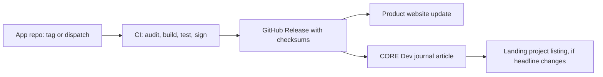

# CORE overview

CORE is Iian Kehn's umbrella brand for software and publishing. Every product
is built in the open on GitHub (`iiankehn/*`) and distributed directly, not
through app stores.

## Portfolio

| Product | Platform | Repository | Status (Oct 2026) |
|---|---|---|---|
| Acute Web for Android | Android 8+, ARM64 and x86_64 | `acute-web-android` | Stable 1.1, Beta 2.0.0-beta.2 |
| Acute Web for iOS and iPadOS | iOS 18+ (tested on iOS 27 only) | `acute-web-ios` | 0.5 sideload beta |
| Slate | Android 12+, ARM64 and x86_64 | `slate-android` | Monthly line, `slate-2026-10` |
| CORE website | Web, core.iiankehn.com | `coredotcom` | 48 stories published |
| CORE Dev | Web, dev.iiankehn.com | `core-dev` | Release journal |
| Landing | Web, www.iiankehn.com | `landing` | Personal site, shared design |

## Shared principles

1. **Privacy by construction.** No telemetry, analytics, advertising, crash
   upload or accounts. The only automatic network traffic is what the user asked for.
2. **Direct, verifiable distribution.** Signed GitHub Releases with checksums.
   Package identities and signing keys are permanent; updates never require uninstalling.
3. **Fail closed.** Builds stop when an assumption no longer holds (an upstream
   patch anchor, a signing certificate, a privacy manifest) instead of continuing.
4. **Honest claims.** Release notes separate automated evidence from device
   testing and list known issues.
5. **Every form factor.** Phone, tablet, large-screen, keyboard and pointer
   input, and accessibility are release requirements.
6. **Small, durable technology.** Native platform toolkits, no third-party
   runtime SDKs in the apps, and websites without frameworks or build steps.

## Brand

- Products are named "Acute Web by CORE" and "Slate by CORE".
- The cat-fox mark is shared: clear-glass for Acute, branded artwork in Slate's start center.
- Websites use a modern, dark-only Metro design: flat tiles, large lightweight
  type, and one accent per site.

## How a release flows

Acute Android updates its own product website automatically. Every other step is
a separate pull request in its repository.
