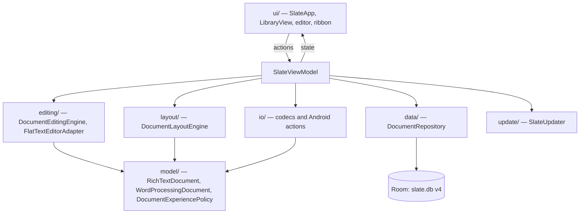

# Slate architecture

A single-activity Kotlin and Jetpack Compose app with unidirectional data flow:
Compose renders state from `SlateViewModel`, user actions update that state, and
`DocumentRepository` persists normalized documents through Room.

## Layers

| Layer | Package and files | Responsibility |
|---|---|---|
| UI | `ui/` (`SlateApp`, `LibraryView`, `LibraryOrganization`, `CanvasPresentation`, `WorkspaceConfiguration`, `theme/SlateTheme`) | Start center, responsive editor, ribbon, dialogs |
| State | `SlateViewModel.kt` | Library operations, editor sessions, autosave, history, import/export, classification |
| Models | `model/` (`Document`, `RichTextDocument`, `WordProcessingDocument`, `DocumentExperiencePolicy`, `DocumentTitlePolicy`) | Device-independent document models |
| Editing | `editing/` | Immutable commands, selection-aware transforms, undo/redo, flat-text adaptation |
| Layout | `layout/DocumentLayoutEngine.kt` | Page geometry and pagination independent of form factor |
| Data | `data/` (`SlateDatabase`, `SlateDao`, `SlateEntities`, `DocumentRepository`) | Room entities, snapshots, recovery checkpoints, migrations |
| Formats | `io/` (`SlxCodec`, `SlxfCodec`, `DocumentFormats`, `DocxImporter`, `LibraryBackupCodec`, `R2DocumentCodec`, `R2DocumentBridge`, `AndroidDocumentActions`) | Packages, interchange formats, printing, sharing |
| Updater | `update/SlateUpdater.kt` | Release discovery, version comparison, bounded download, SHA-256, installer handoff |

`R2*` names come from the former Slate Forge codebase ("R2"); Slate Notes was "R1".

## Adaptive document state

Each document persists an experience: `Adaptive`, `Notes` or `Forge`.
`DocumentExperiencePolicy` derives the visible mode from structure. Adaptive
content shows as Note until it contains an advanced feature, and saving that
edit persists Forge. Explicit or promoted Forge is never downgraded
automatically. The policy is semantic: it never looks at length, word count,
screen size or device class.

## Persistence

- Room database `slate.db`, schema version 4, tables `documents`,
  `rich_text_ranges` and `recovery_entries`.
- Migrations 1→2 (organization fields), 2→3 (`r2Payload` for Forge content)
  and 3→4 (`experience`). Each is additive, with defaults, and mirrored in
  `documents` and `recovery_entries`.
- `exportSchema = false`; there are no migration tests yet.
- Every edit creates a recovery checkpoint, and the current snapshot saves after
  an idle delay. History keeps the newest 30 checkpoints per document.
- Android auto-backup and device transfer are disabled. Uninstalling deletes documents.

## Security boundaries

- Storage Access Framework only: no broad storage permission.
- Imports are bounded and parsed off the UI thread. Codecs validate entry
  counts, sizes, paths and checksums before committing anything.
- Encrypted backup: PBKDF2-HMAC-SHA256 (210,000 iterations; 100,000 to 1,000,000
  accepted on restore), 256-bit AES-GCM, 16-byte salt, 12-byte nonce, 512 MB cap,
  and each embedded `.slxf` verified before preview.
- No routine network requests; cleartext traffic disabled. The only network
  path is the user-triggered update check.

## Build and test

- CI (`android-ci.yml` on `main` and `beta`):
  `gradle --no-daemon testDebugUnitTest lintDebug assembleDebug` with Gradle
  8.13 and JDK 17, plus a native-library architecture check.
- There is no Gradle wrapper in the repository.
- Unit tests cover models, the experience policy, editing engine, layout,
  library restore, codecs (`.slx`, `.slxf`, R2, backup, formats) and UI configuration.
- Emulator smoke tests were removed in October 2026; layout behavior is checked on devices.
